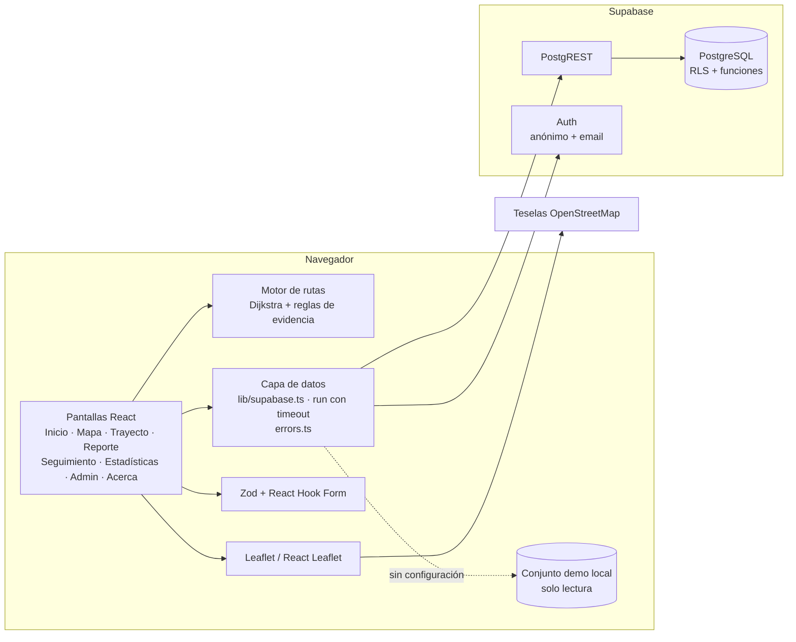
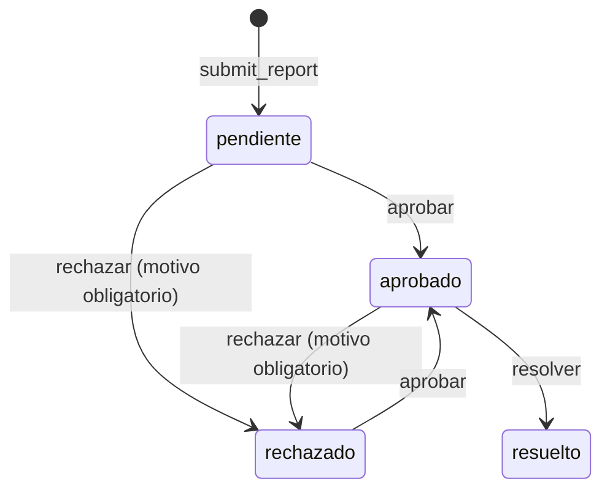
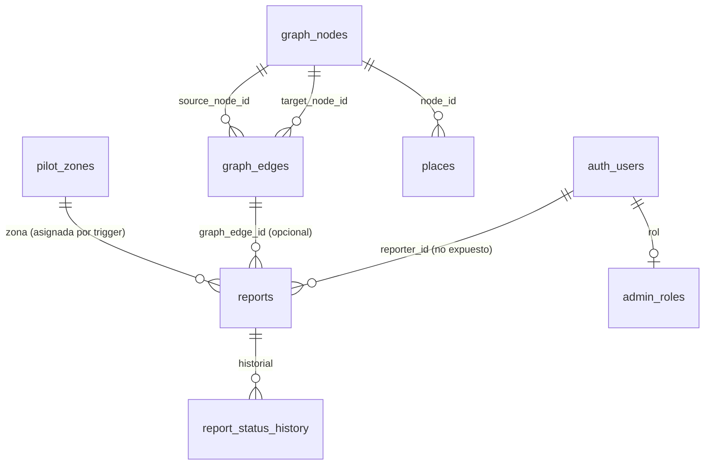

# Arquitectura de MoviAcceso

## 1. Visión general

Aplicación de una sola página (SPA) en React + TypeScript que se comunica directamente con Supabase (PostgreSQL + PostgREST + Auth). No hay servidor propio ni microservicios: la lógica sensible (validación, límites, autorización) vive en **funciones SQL `SECURITY DEFINER`** y **políticas RLS** dentro de PostgreSQL, el punto que el cliente no puede eludir. No hizo falta ninguna Edge Function: todo el procesamiento seguro cabe en SQL.

## 2. Capas

| Capa | Ubicación | Responsabilidad |
|---|---|---|
| Presentación | `src/pages`, `src/components`, `src/features/*/*.tsx` | Pantallas, accesibilidad, estados de carga, error y vacío |
| Lógica de negocio | `src/features/routing` | Grafo, Dijkstra, perfiles, clasificación de evidencia (sin dependencias de UI ni red) |
| Validación | `src/features/reports/schema.ts` | Reglas del formulario (las repite el servidor) |
| Acceso a datos | `src/lib/supabase.ts`, `src/features/*/api.ts`, `dataset-api.ts` | Consultas, tiempo de espera (12 s), traducción de errores, mapeo de filas a tipos de dominio |
| Configuración | `.env*`, `vite.config.ts` | Variables públicas; la clave `service_role` se rechaza explícitamente |
| Persistencia y seguridad | `supabase/migrations` | Esquema, RLS, permisos mínimos, funciones |

## 3. Flujos de datos

### 3.1 Consulta de trayecto
1. `DatasetProvider` carga `graph_nodes`, `graph_edges` y `places` (o el conjunto local demo si Supabase no está configurado, siempre etiquetado).
2. `RoutePage` lee origen, destino, perfil y la opción de datos demo **desde la URL**, así que el detalle del trayecto se puede enlazar.
3. `RoutePlanner.plan()` ejecuta Dijkstra con la función de costo del perfil y devuelve: segmentos orientados, distancia (suma de longitudes geodésicas), veredicto y desglose de evidencia.
4. La UI muestra el veredicto, la advertencia obligatoria, el mapa y la lista textual equivalente.

### 3.2 Registro de reporte
1. El usuario marca la ubicación en el mapa o elige un tramo de la lista. No se usa GPS.
2. Zod valida en el cliente; además hay un campo trampa y un tiempo mínimo de llenado contra bots.
3. `ensureSession()` crea una sesión **anónima** de Supabase si no existe ninguna.
4. `rpc('submit_report')` valida en el servidor: longitudes, rango de severidad, ubicación dentro del piloto, existencia del tramo, límites (5/hora, 20/día por sesión, 100 cada 10 minutos en total) y duplicados en 24 h. Inserta con `reporter_id = auth.uid()`.
5. El cliente muestra el éxito **solo** si el servidor devuelve el `id`; en otro caso muestra «El reporte NO se guardó».

### 3.3 Moderación
`AdminPage` → `is_admin()` (rol en `admin_roles`) → `moderate_report(id, 'aprobar'|'rechazar'|'resolver', motivo)` con una máquina de estados validada en SQL → fila en `report_status_history`. La verificación técnica es otra función (`set_report_verification`) y exige fuente o metodología.

Estado de verificación (independiente): `sin_verificar` ↔ `verificado_en_campo` ↔ `no_confirmado`.

## 4. Motor de rutas: criterios

**Estado efectivo** de un segmento: si su fuente es `simulado` y el usuario desactiva los datos de demostración, se trata como `informacion_insuficiente`. Un dato simulado nunca es evidencia real.

| Perfil | Segmentos permitidos | Costo |
|---|---|---|
| General | Todos | longitud |
| Movilidad reducida | Todos excepto `barrera_verificada` | longitud × 1 (verificado), × 1,5 (insuficiente), × 2,5 (comunitario pendiente) |
| Estricto | Solo `accesible_verificado` | longitud |

**Veredicto del trayecto** (`classifyRoute`):
- `con_barreras`: algún segmento tiene barrera.
- `sin_confirmar`: algún segmento tiene información insuficiente o pendiente.
- `demostrativa`: todos los segmentos están «verificados», pero al menos uno solo en datos simulados.
- `verificada`: todos verificados con fuentes no simuladas.

Salvaguarda: el perfil estricto solo puede devolver `verificada` o `demostrativa`; en otro caso responde «sin trayecto» con el mensaje obligatorio. Los segmentos que referencian nodos inexistentes se descartan al construir el grafo: nunca se inventan conexiones.

## 5. Modelo de datos

Tablas: `places`, `graph_nodes`, `graph_edges`, `reports`, `admin_roles` (requeridas) y además `pilot_zones` y `report_status_history`.

Decisiones:
- **ENUM** para todos los estados (`accessibility_status`, `source_type`, `moderation_status`, `verification_status`, etc.), con los mismos valores que `src/types/domain.ts`.
- `is_simulated` es una columna **generada** (`source_type = 'simulado'`), así que no puede quedar inconsistente.
- Restricción: un estado `accesible_verificado` o `barrera_verificada` exige `verified_at`.
- Geometría como GeoJSON `LineString` en `jsonb`, con restricción de forma. PostGIS se puede adoptar más adelante sin cambiar la API.
- `reporter_id` no tiene permiso de lectura para `anon`/`authenticated` (permiso por columna), para que no se puedan vincular reportes de una misma sesión.
- Índices: estado de moderación + fecha, autor + fecha, zona, categoría, tramo, extremos de segmentos.

## 6. Seguridad

| Requisito | Implementación |
|---|---|
| Sin datos personales innecesarios | Los reportes no tienen nombre, teléfono ni documento; Zod rechaza patrones de DNI o teléfono en la descripción |
| Sin GPS automático | No se usa la API de geolocalización; `Permissions-Policy: geolocation=()` en el despliegue |
| Validación cliente y servidor | Zod + `submit_report()` |
| Inyección SQL / XSS | Consultas parametrizadas de PostgREST; React escapa todo; no se usa `dangerouslySetInnerHTML` (los íconos de Leaflet son HTML estático sin datos del usuario) |
| Sin `service_role` en el frontend | Solo variables `VITE_*` públicas; detección y bloqueo de claves `service_role`/`sb_secret_` |
| Autorización real | `admin_roles` + `is_admin()` dentro de cada función administrativa; RLS en todas las tablas |
| Escrituras no autorizadas | Sin políticas INSERT/UPDATE/DELETE en `reports`; permisos revocados explícitamente (incluido el EXECUTE por defecto a PUBLIC) |
| Envíos masivos | Límites por sesión y globales, duplicados, campo trampa, tiempo mínimo; recomendación de CAPTCHA |
| Solo reportes aprobados públicos | Política RLS `moderation_status in ('aprobado','resuelto')` (o el propio autor, o el admin) |
| Usuarios anónimos no editan reportes ajenos | No existe ninguna vía de UPDATE para ciudadanos (probado en `supabase/tests`) |

## 7. Sustitución de datos simulados (RNF-07)

Todos los componentes trabajan con los tipos de dominio, no con la fuente. Para pasar a datos reales:
1. Importe geometría OSM (`npm run osm:import`): los segmentos entran como `informacion_insuficiente`.
2. Actualice cada tramo inspeccionado con `accessibility_status`, `verified_at`, `source_type = 'inspeccion'` y `source_url` (acta o ficha).
3. Agregue lugares con coordenadas comprobadas y su `node_id`.
4. Borre los datos `simulado` y los reportes `is_demo`. La interfaz deja de mostrar avisos de demostración automáticamente.
